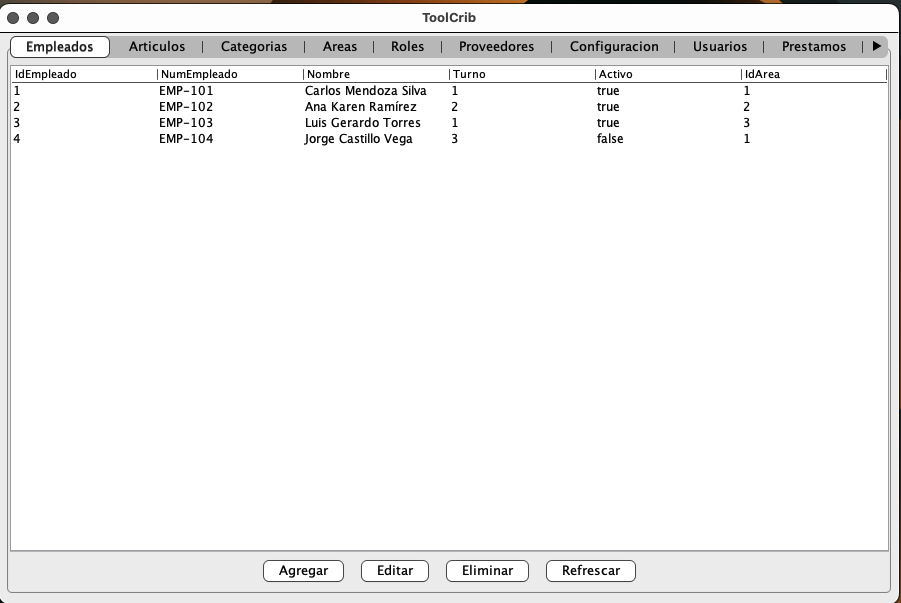
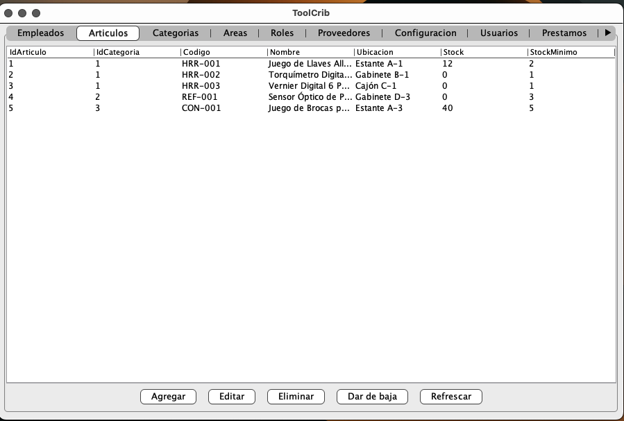
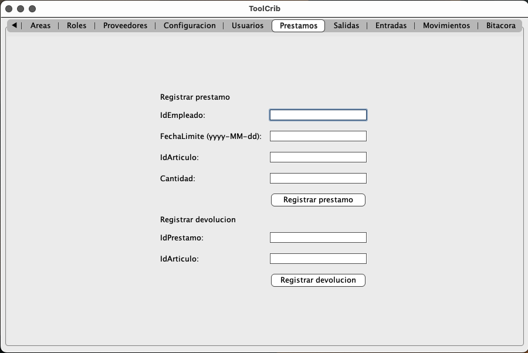

# ToolCrib

Sistema de gestión de herramientas y refacciones para mantenimiento industrial — control de inventario, préstamos de herramienta a empleados, entradas/salidas de almacén y trazabilidad de movimientos.

## Problema que resuelve

En una planta de manufactura, el cuarto de herramientas (*tool crib*) necesita saber en todo momento qué hay en stock, quién tiene prestada una herramienta y cuándo debe devolverla, y quién sacó qué material y para qué área. Hacer esto en papel o en Excel es lento y propenso a errores (herramienta perdida, stock desactualizado, sin registro de quién hizo qué). ToolCrib centraliza todo eso en una aplicación de escritorio con base de datos real.

## Capturas

| Empleados (CRUD) | Articulos (CRUD + baja) | Préstamos (lógica de negocio) |
|---|---|---|
|  |  |  |

## Funcionalidad

- CRUD completo de Empleados, Articulos, Categorias, Areas, Roles, Proveedores, Configuracion y Usuarios.
- Registro de préstamos y devoluciones de herramienta, con control de stock (bloquea el préstamo si no hay suficiente inventario).
- Registro de salidas y entradas de almacén.
- Bitácora y reporte de movimientos de inventario, para trazabilidad completa.
- Validación de reglas de negocio en la base de datos (procedimientos almacenados), no solo en la aplicación.

## Stack

- **Java 21** (Swing para la interfaz de escritorio)
- **SQL Server** (16 tablas, con procedimientos almacenados para la lógica de negocio)
- **Maven** para la gestión del proyecto
- **JDBC** (driver oficial de Microsoft) para la conexión a base de datos

## Arquitectura

MVC + DAO: `Vista` (Swing) → `Controlador` → `Servicio` (reglas de negocio) → `DAO` (acceso a datos) → SQL Server.

## Cómo correrlo

**Requisitos:** JDK 21, Maven (o NetBeans), Docker.

```bash
# 1. Clona el repo
git clone https://github.com/Roger150207/ToolCrib.git
cd ToolCrib

# 2. Levanta SQL Server con Docker Compose
docker-compose up -d

# 3. Crea la base y corre los scripts de /database (tablas, datos de ejemplo, procedimientos)

# 4. Copia src/main/resources/db.properties.example a db.properties
#    y pon ahí tu cadena de conexión real

# 5. Compila y corre
mvn clean install
mvn exec:exec -Dexec.mainClass=com.toolcrib.vista.VentanaPrincipal
```

## Requisitos

- Java 17+
- SQL Server 2019+
- Docker (opcional, para levantar la base de datos con docker-compose)

## Autor

Rogelio Saldaña Colorado — [GitHub](https://github.com/Roger150207)
